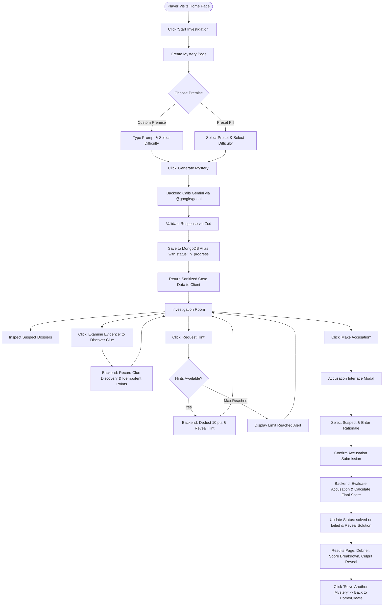

# AI Mystery Room — Technical Specification & Architecture Blueprint

> **Status:** Planning Stage Only  
> **Document Version:** 1.0.0  
> **Last Updated:** October 2026  
> **Submission Deadline:** 2 November, 11:59 PM  
> **Submission Form:** [https://bit.ly/ai-mystery-room-sub-form](https://bit.ly/ai-mystery-room-sub-form)

---

## Table of Contents

1. [Project Overview and Problem Statement](#1-project-overview-and-problem-statement)
2. [Target Users and Expected Experience](#2-target-users-and-expected-experience)
3. [Required Features and Optional Enhancements](#3-required-features-and-optional-enhancements)
4. [Complete User Flow](#4-complete-user-flow)
5. [Detailed Page and UI Specifications](#5-detailed-page-and-ui-specifications)
6. [Difficulty and Scoring Rules](#6-difficulty-and-scoring-rules)
7. [AI-Generated JSON Schema](#7-ai-generated-json-schema)
8. [Backend API Contracts with Example Requests and Responses](#8-backend-api-contracts-with-example-requests-and-responses)
9. [MongoDB Data Model](#9-mongodb-data-model)
10. [Backend Architecture](#10-backend-architecture)
11. [Security and Validation Rules](#11-security-and-validation-rules)
12. [Suggested Project Folder Structure](#12-suggested-project-folder-structure)
13. [Environment Variable Configuration](#13-environment-variable-configuration)
14. [Local Development Setup Commands](#14-local-development-setup-commands)
15. [Testing Strategy](#15-testing-strategy)
16. [Deployment Plan (Backend, MongoDB Atlas, Vercel)](#16-deployment-plan-backend-mongodb-atlas-vercel)
17. [Acceptance Criteria](#17-acceptance-criteria)
18. [Final Deliverables and Submission Checklist](#18-final-deliverables-and-submission-checklist)

---

## 1. Project Overview and Problem Statement

### 1.1 Project Overview
**AI Mystery Room** is an immersive, full-stack, AI-driven detective investigation web game. Players step into the shoes of a lead investigator tasked with solving procedural mystery cases generated on demand. After entering an original crime premise (or selecting a curated starter scenario) and choosing a difficulty setting (Easy, Medium, or Hard), players are transported to a virtual noir investigation room.

Within the investigation room, players examine suspect dossiers, inspect crime scene evidence to uncover hidden clues, request strategic hints when stumped, and ultimately convene an accusation tribunal. Upon submitting their prime suspect and deduction rationale, the system delivers an authoritative verdict, discloses the culprit's motive and method, and tabulates a final score based on deduction accuracy, clues uncovered, and hints used.

### 1.2 Problem Statement
Traditional mystery and puzzle games suffer from fundamental limitations:
1. **Static Replayability:** Hand-crafted mystery games are single-play experiences. Once a player knows the culprit, the puzzle loses all mystery and replay value.
2. **Hallucination & Incoherence in Naive AI Games:** Simple AI text generators often produce contradictory evidence, impossible alibis, or unsolvable logic gaps when not strictly bounded by deterministic schemas and rules.
3. **Cheat Vulnerability in Web Games:** Client-rendered detective games frequently leak the culprit’s identity in frontend state, DOM nodes, or network inspection payloads.
4. **Disjointed User Experience:** Existing text adventures often lack the visual gravitas, atmospheric tension, and tactile feedback of an authentic noir detective pinboard.

### 1.3 Solution
AI Mystery Room resolves these challenges by combining:
- **Google Gemini API (`@google/genai`) with Structured Outputs:** Generating mathematically and logically consistent mystery files bounded by strict JSON schemas.
- **Authoritative Backend State Architecture:** Concealing the true culprit identity and solution narrative in MongoDB Atlas until an accusation is sealed.
- **Deterministic Server-Side Scoring Engine:** Calculating scores strictly on the server to prevent client-side tampering, duplicate point exploitation, or post-case re-accusation.
- **Noir Detective Interface:** Delivering a dark, tension-filled digital investigation corkboard with typewriter typography, evidence markers, suspect mugshots, and case stamps.

---

## 2. Target Users and Expected Experience

### 2.1 Target Audience
- **Mystery & Puzzle Enthusiasts:** Fans of Agatha Christie, Sherlock Holmes, *Knives Out*, escape rooms, and murder mystery board games.
- **Casual Strategy Gamers:** Players looking for an intellectual 10-to-15 minute deduction challenge directly in their desktop or mobile browser.
- **Tech & AI Explorers:** Developers and tech-savvy gamers curious to experience how large language models can act as creative game masters with strict logical coherence.

### 2.2 Expected User Experience & Design Philosophy
- **Atmospheric & Immersive:** Dark noir aesthetic, dossier-style presentation, muted slate/amber/crimson palette, subtle stamp and evidence tag motifs.
- **Fair-Play Deduction:** Every generated case adheres to the golden rule of detective fiction: all clues necessary to identify the culprit are present in the evidence and suspect statements. No unfair leaps of logic.
- **Zero-Friction Interface:** Clear visual hierarchy, accessible touch and keyboard controls, intuitive tabbed views (Suspects, Evidence, Case Log), and readable typography. Usability is prioritized over gratuitous animations.
- **Integrity & Suspense:** The identity of the culprit remains sealed in the evidence vault until the player commits to an accusation. Once committed, the verdict delivers closure and detailed narrative debriefing.

---

## 3. Required Features and Optional Enhancements

### 3.1 Mandatory (Required) Features

| Category | Feature | Description |
|---|---|---|
| **Mystery Creation** | Custom Premise Input | Text area for user-defined premises with character counter, alongside 4 pre-set instant prompt pills. |
| **Mystery Creation** | Difficulty Selection | Explicit selection of Easy (3 suspects / 5 clues / 2 hints), Medium (4 suspects / 7 clues / 3 hints), or Hard (5 suspects / 9 clues / 3 hints). |
| **AI Generation** | Structured Case Synthesis | Integration with `@google/genai` to generate logically sound case files validated against a strict Zod schema. |
| **Investigation** | Suspect Dossier Board | Interactive cards detailing suspects' identities, occupations, backgrounds, alibis, and stated motives. |
| **Investigation** | Clue Discovery System | Interactive evidence board where clues start hidden/unexamined and are unlocked via user action. Duplicate discoveries are prevented from awarding duplicate points. |
| **Investigation** | Progressive Hint Dispenser | Strategic hint system that unlocks clues sequentially up to the difficulty limit, applying a -10 point penalty per hint. |
| **Accusation** | Accusation Interface | Irreversible tribunal modal/view allowing suspect selection and optional player deduction rationale. |
| **Resolution** | Server-Side Verdict & Scoring | Backend calculates score (`max(0, bonus + clues*5 - hints*10)`), reveals culprit, narrative confession, and marks case closed. |
| **Results** | Debriefing & Scoreboard | Comprehensive breakdown of accuracy, points, culprit method/motive explanation, and "Solve Another Mystery" loop. |
| **Security** | Zero-Leak Solution Vault | Culprit ID, confession, and solution explanation are excluded from all client-facing API responses while the case is in progress. |

### 3.2 Optional Enhancements (Post-MVP / Nice-to-Have)

> [!NOTE]  
> The following items are explicitly categorized as **Optional Enhancements**. They are **not** required for the initial MVP submission and must not delay the core deliverables.

- **Atmospheric Audio:** Subtle ambient noir rain/jazz soundtrack and typewriter sound effects with a persistent mute toggle.
- **Investigation Timer:** Optional speed-run countdown clock awarding speed bonus multipliers.
- **Suspect Interrogation Chat:** Dynamic AI chat interface allowing the player to ask up to 3 direct questions to each suspect.
- **Case Dossier PDF Export:** One-click generation of a printable vintage detective case report summarizing the investigation and final verdict.
- **Community Case Board:** Public gallery of high-scoring solved cases that other players can attempt.

---

## 4. Complete User Flow



### 4.1 Step-by-Step Flow Description
1. **Entry & Introduction:** Player lands on Home Page (`/`), reads rules, and clicks **"Start New Investigation"**.
2. **Case Setup:** On `/create`, player chooses a difficulty (Easy, Medium, Hard) and enters an optional custom premise or selects a preset pill (e.g., *"The Poisoned Heirloom at Blackwood Manor"*).
3. **Synthesis & Loading:** Player clicks **"Generate Mystery"**. The app displays an atmospheric loading screen with real-time status pulses while the backend contacts Gemini 1.5, validates the response schema with Zod, and persists the case into MongoDB Atlas.
4. **Investigation Phase:** Player enters `/case/:id`. The interface loads suspects and hidden clues. 
   - Player reviews suspect profiles, comparing alibis against locations.
   - Player clicks unexamined evidence cards to discover clues (+5 points per unique clue).
   - If stuck, player requests a hint (-10 points per hint, capped by difficulty limit).
5. **The Accusation:** Player opens the accusation panel, reviews the suspects, selects the prime culprit, types in an optional deduction summary, and confirms their choice.
6. **Verdict & Score Calculation:** The backend verifies that the case is still `in_progress`, matches the accused suspect against the stored culprit, tabulates the final score with a floor of 0, updates the status to `solved` or `failed`, and returns the full debrief.
7. **Debriefing:** The player is redirected to `/case/:id/result`, viewing their final score, accuracy badge, full explanation of the crime, and an option to launch another investigation.

---

## 5. Detailed Page and UI Specifications

### 5.1 Design System & Aesthetic Foundation
- **Theme:** Noir Detective Agency / Classified Case File.
- **Color Palette:**
  - Background Base: `#0B0F17` (Deep Obsidian)
  - Card & Surface: `#111827` (Charcoal Slate)
  - Surface Border / Accent: `#1F2937` (Muted Steel) & `#374151` (Border Grey)
  - Primary Accent: `#F59E0B` (Amber Gold / Desk Lamp Glow)
  - Secondary Warning: `#EAB308` (Crime Tape Yellow)
  - Failure / Danger: `#EF4444` (Crimson Ink)
  - Success / Solved: `#10B981` (Emerald Seal)
  - Text Primary: `#F3F4F6` (Chalk White)
  - Text Muted: `#9CA3AF` (Typewriter Grey)
- **Typography:**
  - Headings & Stamps: Monospace / Typewriter serif (e.g., `Courier Prime`, `Playfair Display`, or uppercase `ui-monospace`)
  - Body & UI Controls: Clean, legible sans-serif (e.g., `Inter`, system sans)
- **Motifs & Textures:** Manila folder tabs, evidence photo paperclips, "CONFIDENTIAL" watermark stamps, rubber-stamp badges, and polaroid suspect frames.

---

### 5.2 Page 1: Home Page (`/`)
- **Route:** `/`
- **Purpose:** Set the atmospheric tone, explain game mechanics, and prompt the user to start a case.
- **Key UI Sections:**
  1. **Top Navigation Bar:**
     - Title logo: `AI MYSTERY ROOM` (with small amber magnifying glass icon).
     - Link to GitHub repo / Help modal.
     - "New Case" primary action button.
  2. **Hero Section:**
     - Atmospheric headline: *"Every Crime Leaves a Trace. Can You Find It?"*
     - Subheadline: *"Procedurally generated detective mysteries powered by Google Gemini. Inspect clues, interrogate alibis, and unmask the culprit before your lead goes cold."*
     - Primary CTA: Large amber button *"Enter Detective Office"* (links to `/create`).
  3. **How It Works (4-Step Dossier Grid):**
     - Step 1: *Define the Crime* (Set your premise and select investigation difficulty).
     - Step 2: *Examine Evidence* (Uncover hidden physical, testimonial, and forensic clues).
     - Step 3: *Analyze Suspects* (Deconstruct alibis, motives, and conflicting statements).
     - Step 4: *Deliver the Verdict* (Name the culprit, seal the indictment, and claim your score).
  4. **Difficulty Matrix Preview Card:**
     - Side-by-side comparison cards for Easy, Medium, and Hard showing suspect, clue, hint counts, and bonus rewards.
  5. **Footer:**
     - Credits, submission disclaimer, and project timestamp.

---

### 5.3 Page 2: Create Mystery Page (`/create`)
- **Route:** `/create`
- **Purpose:** Configure and synthesize a new procedural mystery case.
- **Key UI Sections:**
  1. **Case Specification Form:**
     - **Premise Textarea:**
       - Label: *"Mystery Premise & Setting (Optional)"*
       - Placeholder: *"E.g., A priceless Renaissance diamond vanishes from a locked museum vault during a blackout in Venice..."*
       - Character counter: `0 / 300` characters.
     - **Quick-Start Preset Pills:**
       - Pill 1: *"The Midnight Express Poisoning"*
       - Pill 2: *"The Vanishing Tech CEO at the Cyber Summit"*
       - Pill 3: *"The Curators Curse in the Parisian Catacombs"*
       - Pill 4: *"The Blackwood Manor Will Reading"*
       - Clicking a pill auto-populates the premise textarea.
     - **Difficulty Selector (Interactive Radio Cards):**
       - **Easy:** 3 Suspects, 5 Clues, 2 Hints | +100 Accusation Bonus.
       - **Medium (Default):** 4 Suspects, 7 Clues, 3 Hints | +150 Accusation Bonus.
       - **Hard:** 5 Suspects, 9 Clues, 3 Hints | +200 Accusation Bonus.
     - **Submission Button:**
       - Full-width amber button: *"Synthesize Case Dossier"*
  2. **Atmospheric Loading Overlay (Active during generation):**
     - Full-screen semi-transparent dark backdrop.
     - Animated magnifying glass or pulsating radar icon.
     - Cycling typewriter status messages:
       - *"Establishing crime scene perimeter..."*
       - *"Collecting eyewitness depositions..."*
       - *"Cataloging forensic evidence in vault..."*
       - *"Sealing classified solution file..."*

---

### 5.4 Page 3: Investigation Room (`/case/:id`)
- **Route:** `/case/:id`
- **Purpose:** Core gameplay hub where player examines evidence and suspects.
- **Key UI Sections:**
  1. **Investigation Header (Sticky):**
     - Case Title: (e.g., *"CASE #8492: THE BLACKWOOD CIPHER"*)
     - Premise Brief: Accordion toggle to review the crime summary.
     - Status Indicators:
       - Difficulty Badge (Easy / Medium / Hard)
       - Clues Discovered Counter: `[ X / Total Clues Found ]`
       - Hints Remaining Counter: `[ Y / Max Hints Remaining ]`
     - Action CTA: Crimson *"Submit Accusation"* button (always accessible).
  2. **Tabbed or Dual-Panel Investigation Workspace:**
     - **Panel A: Suspect Dossiers Grid:**
       - Card per suspect:
         - Polaroid-style avatar placeholder with initials and stamp.
         - Suspect Full Name & Role / Occupation (e.g., *"Eleanor Vance — Lead Archeologist"*).
         - Background Bio & Personality.
         - Stated Alibi (e.g., *"Claims she was in the archives until 11:30 PM"*).
         - Suspected Motive (e.g., *"Faced imminent termination over forged artifacts"*).
     - **Panel B: Evidence Locker & Clue Board:**
       - Interactive cards for each clue:
         - **Undiscovered State:** Dark textured card with padlock icon, labeled *"Unexamined Evidence #X"*. Button: *"Examine Clue (+5 pts)"*.
         - **Discovered State:** Manila paper aesthetic. Displays Clue Title, Evidence Type badge (`Physical`, `Testimonial`, `Forensic`, `Digital`), Location Found, and Detailed Description.
     - **Panel C: Detective's Notebook & Hint Dispenser:**
       - Notebook panel listing revealed hints.
       - *"Request Hint (-10 pts)"* button.
       - Confirmation modal warning: *"Requesting a hint will deduct 10 points from your final score. Proceed?"*
       - Disabled state with badge once maximum hints for difficulty are consumed.

---

### 5.5 Page 4: Accusation Interface (`/case/:id/accuse` or Integrated Modal)
- **Route:** `/case/:id/accuse` (or full-screen focused modal on `/case/:id`)
- **Purpose:** High-stakes tribunal where player commits to their indictment.
- **Key UI Sections:**
  1. **Tribunal Warning Banner:**
     - Prominent warning box: *"CAUTION: Accusations are irreversible. Once an indictment is handed down, the case file is permanently sealed and your final score will be calculated."*
  2. **Suspect Selection Radio Grid:**
     - Visual grid of suspect cards with large selection radio buttons.
     - Selecting a suspect highlights their card with a crimson border and displays a *"PRIME SUSPECT"* stamp.
  3. **Detective's Deduction Rationale (Optional Input):**
     - Text area: *"Outline your closing argument (Why did they do it and how?):"*
     - Provides personal immersion and appears in the final debrief.
  4. **Action Controls:**
     - Secondary button: *"Return to Investigation"* (aborts modal).
     - Primary button: *"Seal Indictment & Demand Verdict"* (triggers confirmation prompt).

---

### 5.6 Page 5: Results Page (`/case/:id/result`)
- **Route:** `/case/:id/result`
- **Purpose:** Post-game debrief, score reveal, and explanation of the solution.
- **Key UI Sections:**
  1. **Verdict Banner:**
     - **Victory:** Glowing emerald border, rubber stamp: *"CASE SOLVED: PERPETRATOR APPREHENDED"*.
     - **Defeat:** Deep crimson border, rubber stamp: *"COLD CASE: WRONG SUSPECT ACCUSED"*.
  2. **Final Score Calculation Breakdown (Itemized Ledger):**
     - Base Accusation Bonus: `+100` / `+150` / `+200` (or `+0` if incorrect).
     - Clues Discovered Bonus: `+5` × `N` clues = `+X pts`.
     - Hints Penalty: `-10` × `M` hints = `-Y pts`.
     - **Total Final Score:** `Z pts` (enforced minimum: `0`).
  3. **The Unvarnished Truth (Case Solution Narrative):**
     - Identity of the True Culprit (Name, Photo card, Motive, and Method).
     - Step-by-Step Crime Breakdown: Full narrative explaining how the crime occurred, why the clues pointed directly to them, and how other suspects' alibis held up.
  4. **Player Closing Argument Review:**
     - Displays the rationale typed by the player during accusation alongside the actual truth.
  5. **Next Steps:**
     - Primary CTA: *"Solve Another Mystery"* (redirects to `/create`).
     - Secondary CTA: *"Return to Headquarters"* (redirects to `/`).

---

## 6. Difficulty and Scoring Rules

### 6.1 Difficulty Matrix

| Parameter | Easy | Medium | Hard |
|---|:---:|:---:|:---:|
| **Number of Suspects** | **3** | **4** | **5** |
| **Total Number of Clues** | **5** | **7** | **9** |
| **Maximum Hints Allowed** | **2** | **3** | **3** |
| **Correct Accusation Bonus** | **+100 pts** | **+150 pts** | **+200 pts** |
| **Points per Discovered Clue** | +5 pts | +5 pts | +5 pts |
| **Penalty per Used Hint** | -10 pts | -10 pts | -10 pts |
| **Minimum Final Score** | 0 pts | 0 pts | 0 pts |

### 6.2 Authoritative Scoring Formula

The final score is computed strictly on the backend upon accusation submission using the deterministic equation:

$$\text{FinalScore} = \max\left(0, \text{AccusationBonus} + (\text{DiscoveredCluesCount} \times 5) - (\text{HintsUsedCount} \times 10)\right)$$

Where:
- $\text{AccusationBonus} = \begin{cases} 100 & \text{if Easy and Accused Suspect} = \text{Culprit} \\ 150 & \text{if Medium and Accused Suspect} = \text{Culprit} \\ 200 & \text{if Hard and Accused Suspect} = \text{Culprit} \\ 0 & \text{if Accused Suspect} \neq \text{Culprit} \end{cases}$
- $\text{DiscoveredCluesCount} = \text{number of unique clue IDs recorded in } \text{discoveredClueIds}$
- $\text{HintsUsedCount} = \text{number of unique hint IDs recorded in } \text{revealedHintIds}$
- $\text{FinalScore} \ge 0$ (Scores cannot be negative).

### 6.3 Integrity & State Constraints
1. **Server Authority:** The frontend never sends point values or score increments. All score calculations are executed in `scoringService.js` on the server.
2. **Idempotent Clue Discovery:** Discovering an already-discovered clue does not award additional points or increment the discovered count.
3. **Strict Hint Ceilings:** Attempting to request a hint beyond the difficulty's maximum threshold rejects with HTTP `400 Bad Request`.
4. **Single Accusation Lock:** Once a case status transitions from `in_progress` to `solved` or `failed`, subsequent calls to `POST /api/cases/:id/accuse` immediately return HTTP `400 Bad Request` ("Case is already closed").

---

## 7. AI-Generated JSON Schema

The backend uses `@google/genai` (official Google Gen AI SDK) with structured outputs (`responseSchema`) to enforce strict compliance with the following schema.

### 7.1 Zod Validation Schema (`caseGenerationSchema.js`)

```javascript
import { z } from 'zod';

export const suspectSchema = z.object({
  id: z.string().regex(/^suspect-[1-5]$/, "ID must follow format suspect-N"),
  name: z.string().min(2).max(100),
  role: z.string().min(2).max(100),
  bio: z.string().min(10).max(500),
  alibi: z.string().min(10).max(500),
  potentialMotive: z.string().min(10).max(500),
});

export const clueSchema = z.object({
  id: z.string().regex(/^clue-[1-9]$/, "ID must follow format clue-N"),
  title: z.string().min(2).max(100),
  description: z.string().min(10).max(500),
  type: z.enum(['physical', 'testimonial', 'forensic', 'digital']),
  locationFound: z.string().min(2).max(100),
  relatedSuspectId: z.string().regex(/^suspect-[1-5]$/).nullable(),
});

export const hintSchema = z.object({
  id: z.string().regex(/^hint-[1-3]$/, "ID must follow format hint-N"),
  order: z.number().int().min(1).max(3),
  text: z.string().min(10).max(300),
});

export const solutionSchema = z.object({
  culpritId: z.string().regex(/^suspect-[1-5]$/),
  culpritName: z.string().min(2).max(100),
  motive: z.string().min(10).max(500),
  method: z.string().min(10).max(500),
  explanation: z.string().min(20).max(2000),
});

export const caseGenerationSchema = z.object({
  title: z.string().min(3).max(150),
  premise: z.string().min(10).max(1000),
  crimeSceneSummary: z.string().min(20).max(1000),
  difficulty: z.enum(['easy', 'medium', 'hard']),
  suspects: z.array(suspectSchema),
  clues: z.array(clueSchema),
  hints: z.array(hintSchema),
  solution: solutionSchema,
}).superRefine((data, ctx) => {
  // Validate exact count of suspects, clues, hints based on difficulty
  const counts = {
    easy: { suspects: 3, clues: 5, hints: 2 },
    medium: { suspects: 4, clues: 7, hints: 3 },
    hard: { suspects: 5, clues: 9, hints: 3 },
  }[data.difficulty];

  if (data.suspects.length !== counts.suspects) {
    ctx.addIssue({
      code: z.ZodIssueCode.custom,
      message: `${data.difficulty} difficulty must contain exactly ${counts.suspects} suspects; received ${data.suspects.length}.`,
      path: ['suspects'],
    });
  }

  if (data.clues.length !== counts.clues) {
    ctx.addIssue({
      code: z.ZodIssueCode.custom,
      message: `${data.difficulty} difficulty must contain exactly ${counts.clues} clues; received ${data.clues.length}.`,
      path: ['clues'],
    });
  }

  if (data.hints.length !== counts.hints) {
    ctx.addIssue({
      code: z.ZodIssueCode.custom,
      message: `${data.difficulty} difficulty must contain exactly ${counts.hints} hints; received ${data.hints.length}.`,
      path: ['hints'],
    });
  }

  // Ensure culpritId matches one of the generated suspects
  const suspectIds = new Set(data.suspects.map(s => s.id));
  if (!suspectIds.has(data.solution.culpritId)) {
    ctx.addIssue({
      code: z.ZodIssueCode.custom,
      message: `solution.culpritId (${data.solution.culpritId}) does not match any valid suspect ID.`,
      path: ['solution', 'culpritId'],
    });
  }
});
```

### 7.2 Gemini System Prompt Specification

```text
You are the Grandmaster Mystery Architect for AI Mystery Room.
Your task is to craft an original, solvable, fair-play detective mystery adhering strictly to the requested difficulty level.

DIFFICULTY RULES:
- easy: exactly 3 suspects (ids: suspect-1, suspect-2, suspect-3), 5 clues (clue-1 to clue-5), 2 hints (hint-1 to hint-2).
- medium: exactly 4 suspects (ids: suspect-1 to suspect-4), 7 clues (clue-1 to clue-7), 3 hints (hint-1 to hint-3).
- hard: exactly 5 suspects (ids: suspect-1 to suspect-5), 9 clues (clue-1 to clue-9), 3 hints (hint-1 to hint-3).

CRITICAL LOGICAL INTEGRITY RULES:
1. FAIR-PLAY DEDUCTION: The crime must have exactly ONE true culprit among the suspects.
2. LOGICAL COHERENCE: The clues must definitively point to the true culprit while providing solid alibis or exonerating details for the innocent suspects.
3. HINTS: Hints must be progressive. Hint 1 points to a suspicious inconsistency; Hint 2 points toward a physical/digital connection; Hint 3 narrows down the prime contradiction.
4. JSON PURITY: Return only valid JSON conforming strictly to the response schema without markdown backticks.
```

---

## 8. Backend API Contracts with Example Requests and Responses

Base API URL: `/api/cases`

---

### 8.1 Create Case
- **Endpoint:** `POST /api/cases`
- **Description:** Generates a new procedural mystery case using Gemini, persists it to MongoDB Atlas, and returns the case metadata sanitized of the solution.
- **Request Body:**
```json
{
  "premise": "A rare emerald scarab is stolen from the penthouse safe during a lightning storm.",
  "difficulty": "easy"
}
```
- **Response (201 Created):**
```json
{
  "success": true,
  "data": {
    "_id": "67223b5f92a1d2e8b01a4e10",
    "title": "The Storm at the Penthouse",
    "premise": "A rare emerald scarab is stolen from the penthouse safe during a lightning storm.",
    "crimeSceneSummary": "Rain lashes against the shattered balcony glass. The safe door hangs ajar with no signs of explosive entry.",
    "difficulty": "easy",
    "status": "in_progress",
    "suspects": [
      {
        "id": "suspect-1",
        "name": "Marcus Vance",
        "role": "Personal Butler",
        "bio": "Served the household for twelve years. Known for meticulous record keeping.",
        "alibi": "Claims he was preparing chamomile tea in the downstairs kitchen.",
        "potentialMotive": "Owed substantial gambling debts to an underground casino."
      },
      {
        "id": "suspect-2",
        "name": "Sonia Morales",
        "role": "Visiting Gemologist",
        "bio": "Arrived from Madrid to appraise the scarab prior to auction.",
        "alibi": "States she was reading in the guest library on the second floor.",
        "potentialMotive": "Stated publicly that the scarab belonged in a European museum."
      },
      {
        "id": "suspect-3",
        "name": "Julian Fox",
        "role": "Security Technician",
        "bio": "Contractor hired to overhaul the penthouse biometric sensors.",
        "alibi": "Claims he was resetting the breaker panel in the basement during the blackout.",
        "potentialMotive": "Possessed the technical bypass codes for the digital safe."
      }
    ],
    "clues": [
      {
        "id": "clue-1",
        "title": "Wet Muddy Footprint",
        "type": "physical",
        "locationFound": "Balcony Terrace",
        "isDiscovered": false
      },
      {
        "id": "clue-2",
        "title": "Peculiar Teacup Smear",
        "type": "forensic",
        "locationFound": "Kitchen Counter",
        "isDiscovered": false
      },
      {
        "id": "clue-3",
        "title": "Basement Breaker Log",
        "type": "digital",
        "locationFound": "Electrical Panel",
        "isDiscovered": false
      },
      {
        "id": "clue-4",
        "title": "Library Window Latch",
        "type": "physical",
        "locationFound": "Second Floor Library",
        "isDiscovered": false
      },
      {
        "id": "clue-5",
        "title": "Torn Velvet Glove Fiber",
        "type": "forensic",
        "locationFound": "Safe Door Hinge",
        "isDiscovered": false
      }
    ],
    "discoveredClueIds": [],
    "revealedHints": [],
    "maxHints": 2,
    "createdAt": "2026-10-29T12:00:00.000Z"
  }
}
```

---

### 8.2 Get Case by ID
- **Endpoint:** `GET /api/cases/:id`
- **Description:** Retrieves the current state of an ongoing or completed case. If `in_progress`, the `solution` and `score` remain omitted.
- **Request Parameters:** `id` (MongoDB ObjectId)
- **Response (200 OK - Case In Progress):**
```json
{
  "success": true,
  "data": {
    "_id": "67223b5f92a1d2e8b01a4e10",
    "title": "The Storm at the Penthouse",
    "premise": "A rare emerald scarab is stolen from the penthouse safe during a lightning storm.",
    "crimeSceneSummary": "Rain lashes against the shattered balcony glass. The safe door hangs ajar with no signs of explosive entry.",
    "difficulty": "easy",
    "status": "in_progress",
    "suspects": [ ... ],
    "clues": [
      {
        "id": "clue-1",
        "title": "Wet Muddy Footprint",
        "description": "A size 9 work boot print in wet potting soil on the balcony tiles.",
        "type": "physical",
        "locationFound": "Balcony Terrace",
        "relatedSuspectId": "suspect-3",
        "isDiscovered": true
      },
      {
        "id": "clue-2",
        "title": "Peculiar Teacup Smear",
        "type": "forensic",
        "locationFound": "Kitchen Counter",
        "isDiscovered": false
      }
    ],
    "discoveredClueIds": ["clue-1"],
    "revealedHints": [
      {
        "id": "hint-1",
        "order": 1,
        "text": "Notice the tread pattern on the balcony does not match domestic slippers."
      }
    ],
    "maxHints": 2,
    "createdAt": "2026-10-29T12:00:00.000Z"
  }
}
```

---

### 8.3 Discover Clue
- **Endpoint:** `POST /api/cases/:id/clues/:clueId/discover`
- **Description:** Marks a clue as discovered. Idempotent: repeating the call for an already discovered clue returns 200 without duplicate points.
- **Request Parameters:** `id` (case ID), `clueId` (e.g., `clue-2`)
- **Request Body:** `{}`
- **Response (200 OK):**
```json
{
  "success": true,
  "message": "Clue examined and cataloged into evidence.",
  "data": {
    "discoveredClue": {
      "id": "clue-2",
      "title": "Peculiar Teacup Smear",
      "description": "Traces of industrial grease are smudged onto the porcelain handle.",
      "type": "forensic",
      "locationFound": "Kitchen Counter",
      "relatedSuspectId": "suspect-3",
      "isDiscovered": true
    },
    "discoveredClueIds": ["clue-1", "clue-2"],
    "totalDiscovered": 2
  }
}
```

---

### 8.4 Request Hint
- **Endpoint:** `POST /api/cases/:id/hints`
- **Description:** Unlocks the next progressive hint for the case. Deducts 10 points during final scoring. Fails with 400 if max hints reached.
- **Request Parameters:** `id` (case ID)
- **Request Body:** `{}`
- **Response (200 OK):**
```json
{
  "success": true,
  "message": "Hint revealed by the senior investigator.",
  "data": {
    "newHint": {
      "id": "hint-2",
      "order": 2,
      "text": "The breaker panel was switched off manually from inside the residence 10 minutes prior to the thunder strike."
    },
    "revealedHints": [
      {
        "id": "hint-1",
        "order": 1,
        "text": "Notice the tread pattern on the balcony does not match domestic slippers."
      },
      {
        "id": "hint-2",
        "order": 2,
        "text": "The breaker panel was switched off manually from inside the residence 10 minutes prior to the thunder strike."
      }
    ],
    "hintsUsedCount": 2,
    "maxHints": 2
  }
}
```

---

### 8.5 Submit Accusation
- **Endpoint:** `POST /api/cases/:id/accuse`
- **Description:** Submits the player's final suspect accusation. Seals the case, calculates the score on the server, updates case status to `solved` or `failed`, and unlocks the full solution.
- **Request Parameters:** `id` (case ID)
- **Request Body:**
```json
{
  "suspectId": "suspect-3",
  "rationale": "Julian used his access to the basement breaker to kill the power, staged the balcony entry with muddy work boots, and left industrial grease on the teacup when he searched the kitchen."
}
```
- **Response (200 OK):**
```json
{
  "success": true,
  "message": "Verdict rendered and case file sealed.",
  "data": {
    "verdict": {
      "isCorrect": true,
      "status": "solved",
      "accusedSuspectId": "suspect-3"
    },
    "score": {
      "total": 90,
      "breakdown": {
        "bonus": 100,
        "cluesBonus": 10,
        "hintsPenalty": 20
      }
    },
    "solution": {
      "culpritId": "suspect-3",
      "culpritName": "Julian Fox",
      "motive": "Possessed the technical bypass codes for the digital safe and intended to fence the scarab overseas.",
      "method": "Staged a phony exterior break-in by leaving muddy boots on the balcony, then disabled the breakers from within.",
      "explanation": "Julian Fox used his inside knowledge of the newly installed security system. The grease on the teacup tied directly to his tool belt, and the circuit breaker logs proved the power cut preceded the exterior window breach."
    }
  }
}
```

---

### 8.6 Get Case Result
- **Endpoint:** `GET /api/cases/:id/result`
- **Description:** Retrieves the final results, score ledger, and complete solution of a sealed case. Returns 400 if the case is still `in_progress`.
- **Request Parameters:** `id` (case ID)
- **Response (200 OK):**
```json
{
  "success": true,
  "data": {
    "caseId": "67223b5f92a1d2e8b01a4e10",
    "title": "The Storm at the Penthouse",
    "difficulty": "easy",
    "status": "solved",
    "isCorrect": true,
    "accusedSuspect": {
      "id": "suspect-3",
      "name": "Julian Fox",
      "role": "Security Technician"
    },
    "score": {
      "total": 90,
      "breakdown": {
        "bonus": 100,
        "cluesBonus": 10,
        "hintsPenalty": 20
      }
    },
    "solution": {
      "culpritId": "suspect-3",
      "culpritName": "Julian Fox",
      "motive": "Possessed the technical bypass codes for the digital safe and intended to fence the scarab overseas.",
      "method": "Staged a phony exterior break-in by leaving muddy boots on the balcony, then disabled the breakers from within.",
      "explanation": "Julian Fox used his inside knowledge of the newly installed security system. The grease on the teacup tied directly to his tool belt, and the circuit breaker logs proved the power cut preceded the exterior window breach."
    },
    "playerRationale": "Julian used his access to the basement breaker...",
    "closedAt": "2026-10-29T12:15:00.000Z"
  }
}
```

---

## 9. MongoDB Data Model

### 9.1 Mongoose Schema Specification (`server/src/models/Case.js`)

```javascript
import mongoose from 'mongoose';

const SuspectSchema = new mongoose.Schema({
  id: { type: String, required: true }, // e.g., 'suspect-1'
  name: { type: String, required: true },
  role: { type: String, required: true },
  bio: { type: String, required: true },
  alibi: { type: String, required: true },
  potentialMotive: { type: String, required: true },
}, { _id: false });

const ClueSchema = new mongoose.Schema({
  id: { type: String, required: true }, // e.g., 'clue-1'
  title: { type: String, required: true },
  description: { type: String, required: true },
  type: {
    type: String,
    enum: ['physical', 'testimonial', 'forensic', 'digital'],
    required: true,
  },
  locationFound: { type: String, required: true },
  relatedSuspectId: { type: String, default: null },
}, { _id: false });

const HintSchema = new mongoose.Schema({
  id: { type: String, required: true }, // e.g., 'hint-1'
  order: { type: Number, required: true },
  text: { type: String, required: true },
}, { _id: false });

const SolutionSchema = new mongoose.Schema({
  culpritId: { type: String, required: true },
  culpritName: { type: String, required: true },
  motive: { type: String, required: true },
  method: { type: String, required: true },
  explanation: { type: String, required: true },
}, { _id: false });

const ScoreBreakdownSchema = new mongoose.Schema({
  bonus: { type: Number, default: 0 },
  cluesBonus: { type: Number, default: 0 },
  hintsPenalty: { type: Number, default: 0 },
}, { _id: false });

const CaseSchema = new mongoose.Schema({
  title: { type: String, required: true, trim: true },
  premise: { type: String, required: true, trim: true },
  crimeSceneSummary: { type: String, required: true },
  difficulty: {
    type: String,
    enum: ['easy', 'medium', 'hard'],
    required: true,
  },
  status: {
    type: String,
    enum: ['in_progress', 'solved', 'failed'],
    default: 'in_progress',
    index: true,
  },
  suspects: [SuspectSchema],
  clues: [ClueSchema],
  hints: [HintSchema],
  solution: { type: SolutionSchema, required: true },
  discoveredClueIds: {
    type: [String],
    default: [],
  },
  revealedHintIds: {
    type: [String],
    default: [],
  },
  accusedSuspectId: {
    type: String,
    default: null,
  },
  accusationRationale: {
    type: String,
    default: null,
  },
  isCorrectAccusation: {
    type: Boolean,
    default: null,
  },
  score: {
    type: Number,
    default: 0,
  },
  scoreBreakdown: {
    type: ScoreBreakdownSchema,
    default: () => ({ bonus: 0, cluesBonus: 0, hintsPenalty: 0 }),
  },
}, {
  timestamps: true,
});

// Helper method to sanitize case data for client consumption
CaseSchema.methods.toClientJSON = function () {
  const obj = this.toObject();
  
  // If case is still in progress, strip secret fields
  if (obj.status === 'in_progress') {
    delete obj.solution;
    delete obj.accusedSuspectId;
    delete obj.accusationRationale;
    delete obj.isCorrectAccusation;
    delete obj.score;
    delete obj.scoreBreakdown;

    // Sanitize clues: hide description and relatedSuspectId if not yet discovered
    obj.clues = obj.clues.map(clue => {
      const isDiscovered = obj.discoveredClueIds.includes(clue.id);
      if (!isDiscovered) {
        return {
          id: clue.id,
          title: clue.title,
          type: clue.type,
          locationFound: clue.locationFound,
          isDiscovered: false,
        };
      }
      return {
        ...clue,
        isDiscovered: true,
      };
    });

    // Only expose hints that have been explicitly revealed
    obj.revealedHints = obj.hints
      .filter(hint => obj.revealedHintIds.includes(hint.id))
      .sort((a, b) => a.order - b.order);
    delete obj.hints;
  } else {
    // For completed cases, mark all clues discovered and expose solution
    obj.clues = obj.clues.map(clue => ({
      ...clue,
      isDiscovered: obj.discoveredClueIds.includes(clue.id),
    }));
    obj.revealedHints = obj.hints;
  }

  // Max hints count based on difficulty
  const maxHintsMap = { easy: 2, medium: 3, hard: 3 };
  obj.maxHints = maxHintsMap[obj.difficulty];

  return obj;
};

export default mongoose.model('Case', CaseSchema);
```

---

## 10. Backend Architecture

### 10.1 Express Architecture Diagram

```
[ Incoming HTTP Request ]
           │
           ▼
[ Express App (app.js) ]
     ├── helmet() (Security headers)
     ├── cors(corsOptions) (Origin restriction)
     ├── express.json({ limit: '1mb' })
     └── morgan('dev') (Logging)
           │
           ▼
[ Route Handler: /api/cases ] (caseRoutes.js)
     ├── validateRequest(zodSchema) (Input sanitization)
     └── caseController.js
           ├── geminiService.js (Calls @google/genai SDK)
           ├── scoringService.js (Deterministic score logic)
           └── Case Model (Mongoose + MongoDB Atlas)
           │
           ▼
[ Centralized Error Handler ] (errorHandler.js)
     └── Safe JSON Response (No stack traces in production)
```

### 10.2 Service Layer Breakdown
1. **`geminiService.js`:**
   - Instantiates `GoogleGenAI` using `process.env.GEMINI_API_KEY`.
   - Constructs prompts based on the premise and requested difficulty level.
   - Enforces structured JSON output via Gemini model configuration.
   - Validates the resulting JSON using `caseGenerationSchema.parse()`.
   - Implements retry logic (up to 2 retries) if Gemini returns invalid JSON.
2. **`scoringService.js`:**
   - Calculates accusation bonus based on difficulty and correctness.
   - Computes clue bonus ($+5$ per unique discovered clue).
   - Computes hint penalty ($-10$ per revealed hint).
   - Enforces final score floor at $0$.
3. **`caseController.js`:**
   - Manages CRUD lifecycle and ensures transitions adhere strictly to state constraints.
   - Converts internal Mongoose models to sanitized client payloads via `toClientJSON()`.

---

## 11. Security and Validation Rules

### 11.1 Secret & Credential Protection
- **Zero Frontend Leakage:** The Gemini API key (`GEMINI_API_KEY`) and MongoDB Atlas connection string (`MONGODB_URI`) exist strictly in the backend `.env` file. They are never imported, referenced, or built into Vite client bundles.
- **Git Hygiene:** Root `.gitignore` explicitly ignores `.env`, `.env.local`, `.env.*.local`, `node_modules/`, and build artifacts.

### 11.2 Culprit & Solution Encapsulation
- While a case is in status `in_progress`:
  - The `solution` object (`culpritId`, `culpritName`, `motive`, `method`, `explanation`) is deleted from MongoDB output before transmitting JSON to the client.
  - Clue descriptions and `relatedSuspectId` fields for undiscovered clues are stripped.
  - Locked hints are never sent in network payloads.
- The culprit identity is only transmitted after the player submits `POST /api/cases/:id/accuse`.

### 11.3 Request Validation with Zod
- Every incoming endpoint payload is validated using Zod middleware before entering controllers:
  - `POST /api/cases`: Validates `difficulty` (`easy | medium | hard`), `premise` (string, max 300 chars, trimmed).
  - `POST /api/cases/:id/accuse`: Validates `suspectId` (string, matching `suspect-[1-5]`), `rationale` (optional string, max 1000 chars).
  - URL parameters: Validates MongoDB ObjectId format (`/^[0-9a-fA-F]{24}$/`).

### 11.4 AI Response Defensive Validation
- LLM outputs can occasionally hallucinate fields or violate array counts. The backend intercepts Gemini responses and validates them against `caseGenerationSchema`:
  - If validation fails, the service logs the error and retries the prompt with a correction instruction.
  - If retries fail, it throws a safe error to the client without exposing internal prompt templates.

---

## 12. Suggested Project Folder Structure

```
ai_mastery_room/
├── .gitignore
├── package.json                   # Root package for orchestration scripts
├── README.md                      # Project overview & quickstart
├── SPEC.md                        # Master technical specification
│
├── client/                        # Frontend React Application
│   ├── index.html
│   ├── package.json
│   ├── vite.config.js
│   ├── tailwind.config.js
│   ├── postcss.config.js
│   ├── .env.example
│   ├── public/
│   │   └── favicon.ico
│   └── src/
│       ├── api/
│       │   └── caseApi.js         # Axios client and case API calls
│       ├── assets/
│       │   └── textures/          # Manila folder & paper textures
│       ├── components/
│       │   ├── common/
│       │   │   ├── Badge.jsx      # Difficulty and status tags
│       │   │   ├── Button.jsx     # Themed noir buttons
│       │   │   ├── Card.jsx       # Slate card container
│       │   │   ├── Modal.jsx      # Accessible modal wrapper
│       │   │   └── Navbar.jsx     # Main navigation header
│       │   ├── investigation/
│       │   │   ├── ClueBoard.jsx       # Evidence grid
│       │   │   ├── ClueCard.jsx        # Flippable evidence card
│       │   │   ├── HintPanel.jsx       # Detective notebook & hint trigger
│       │   │   ├── SuspectCard.jsx     # Suspect dossier card
│       │   │   └── SuspectList.jsx     # Suspects grid
│       │   └── accusation/
│       │       └── AccusationModal.jsx # Tribunal modal & rationale input
│       ├── context/
│       │   └── CaseContext.jsx    # React Context for active case state
│       ├── pages/
│       │   ├── HomePage.jsx       # Landing page & overview
│       │   ├── CreatePage.jsx     # Mystery setup & difficulty picker
│       │   ├── InvestigationPage.jsx # Main investigation room
│       │   └── ResultsPage.jsx    # Verdict, score ledger, and debrief
│       ├── App.jsx                # React Router definitions
│       ├── index.css              # Tailwind directives & noir typography
│       └── main.jsx               # React DOM entry point
│
└── server/                        # Backend Node.js Express Application
    ├── package.json
    ├── .env.example
    └── src/
        ├── config/
        │   ├── db.js              # Mongoose connection logic
        │   └── gemini.js          # GoogleGenAI client initialization
        ├── controllers/
        │   └── caseController.js  # Request handlers for /api/cases
        ├── middleware/
        │   ├── errorHandler.js    # Global error response handler
        │   └── validateRequest.js # Zod validation middleware
        ├── models/
        │   └── Case.js            # Mongoose Case model
        ├── routes/
        │   └── caseRoutes.js      # Express router for case endpoints
        ├── schemas/
        │   ├── caseRequestSchemas.js   # Zod schemas for HTTP inputs
        │   └── caseGenerationSchema.js # Zod schema for Gemini outputs
        ├── services/
        │   ├── geminiService.js   # Prompt engineering & Gemini SDK wrapper
        │   └── scoringService.js  # Server-side scoring engine
        ├── utils/
        │   └── logger.js          # Structured logging utility
        ├── app.js                 # Express application configuration
        └── server.js              # Server listener entry point
```

---

## 13. Environment Variable Configuration

### 13.1 Client Configuration (`client/.env.example`)

```bash
# Base URL for the Express backend API
VITE_API_BASE_URL=http://localhost:5000/api
```

> [!CAUTION]  
> Never define `GEMINI_API_KEY` or `MONGODB_URI` in the `client/.env` file. Any variable prefixed with `VITE_` is bundled into the client build and publicly exposed to any web browser.

### 13.2 Server Configuration (`server/.env.example`)

```bash
# Server Port
PORT=5000

# Environment Mode
NODE_ENV=development

# MongoDB Atlas Connection URI
MONGODB_URI=mongodb+srv://<username>:<password>@<cluster>.mongodb.net/ai_mystery_room?retryWrites=true&w=majority

# Google Gemini API Key
GEMINI_API_KEY=AIzaSyYourGeminiApiKeyHere

# Allowed Client Origin for CORS
CLIENT_URL=http://localhost:5173
```

---

## 14. Local Development Setup Commands

### 14.1 Prerequisites
- **Node.js:** v18.0.0 or higher
- **npm:** v9.0.0 or higher
- **MongoDB Atlas Account:** Active cluster with a database user and IP network access configured.
- **Google AI Studio Key:** Active Gemini API key from [Google AI Studio](https://aistudio.google.com/).

### 14.2 Step-by-Step Installation

#### 1. Setup Backend Server
```bash
# Navigate to the server directory
cd server

# Install backend dependencies
npm install

# Create environment file from example
cp .env.example .env

# Edit .env with your MongoDB Atlas URI and Gemini API key
# Then start the server in development mode
npm run dev
```
*The server will start listening at `http://localhost:5000`.*

#### 2. Setup Frontend Client
```bash
# Open a new terminal and navigate to client directory
cd client

# Install frontend dependencies
npm install

# Create environment file from example
cp .env.example .env

# Start the Vite development server
npm run dev
```
*The frontend will start at `http://localhost:5173`.*

#### 3. Root Level Convenience Scripts (Optional `package.json`)
```json
{
  "name": "ai-mystery-room-root",
  "scripts": {
    "install:all": "npm install --prefix server && npm install --prefix client",
    "dev:server": "npm run dev --prefix server",
    "dev:client": "npm run dev --prefix client"
  }
}
```

---

## 15. Testing Strategy

### 15.1 Unit Testing (Jest / Vitest)
- **Scoring Engine (`scoringService.test.js`):**
  - Verify Easy mode correct accusation yields $100 + (5 \times \text{clues}) - (10 \times \text{hints})$.
  - Verify Medium mode correct accusation yields $150 + (5 \times \text{clues}) - (10 \times \text{hints})$.
  - Verify Hard mode correct accusation yields $200 + (5 \times \text{clues}) - (10 \times \text{hints})$.
  - Verify incorrect accusation yields $0$ bonus points.
  - Verify duplicate clue discoveries do not increment points.
  - Verify boundary condition: final score never drops below $0$.
- **Zod AI Validation (`caseGenerationSchema.test.js`):**
  - Test valid case payloads across Easy, Medium, and Hard configurations.
  - Test rejection when suspect counts mismatch difficulty rules.
  - Test rejection when `solution.culpritId` references a non-existent suspect.

### 15.2 Integration Testing (Supertest)
- **API Endpoint Verification (`caseApi.test.js`):**
  - `POST /api/cases`: Returns 201 and omits `solution`.
  - `GET /api/cases/:id`: Returns sanitized object while in progress.
  - `POST /api/cases/:id/clues/:clueId/discover`: Marks clue discovered and ensures idempotent response.
  - `POST /api/cases/:id/hints`: Rejects with 400 when hint ceiling is reached.
  - `POST /api/cases/:id/accuse`: Returns 200 with verdict, score, and solution; verifies that a second call returns 400.
  - `GET /api/cases/:id/result`: Returns 400 if called while `in_progress`, returns 200 with full breakdown once sealed.

### 15.3 End-to-End Manual Verification Checklist
1. Launch app on `http://localhost:5173`.
2. Generate an Easy case with prompt *"The Vault Heist"*.
3. Verify exactly 3 suspects, 5 clues, and 2 max hints are present.
4. Open Chrome DevTools > Network tab. Inspect `GET /api/cases/:id` response. Verify `solution` and `culpritId` are absent.
5. Click to discover 2 clues. Verify clue counter reads `2 / 5`.
6. Request 1 hint. Verify hint text is displayed and hint counter reads `1 / 2 remaining`.
7. Submit an accusation for the correct culprit. Verify score is calculated accurately: $100 + (2 \times 5) - (1 \times 10) = 100$.
8. Verify redirect to `/case/:id/result` showing the emerald victory seal and full culprit confession.
9. Attempt to call `POST /api/cases/:id/accuse` via Postman on the solved case. Verify server rejects with `400 Bad Request`.

---

## 16. Deployment Plan (Backend, MongoDB Atlas, Vercel)

### 16.1 Database Deployment: MongoDB Atlas
1. Log in to [MongoDB Atlas](https://www.mongodb.com/atlas).
2. Create a free shared cluster (`M0 Sandbox`).
3. Under **Database Access**, create a user `mystery_admin` with read/write privileges.
4. Under **Network Access**, add IP address `0.0.0.0/0` (allow access from anywhere) to allow hosting platforms to connect.
5. Copy the connection string URI and set database name to `ai_mystery_room`.

### 16.2 Backend Deployment: Render (or Railway)
1. Push repository to GitHub.
2. Log in to [Render](https://render.com/) and create a new **Web Service**.
3. Connect the GitHub repository and specify Root Directory: `server`.
4. Configure Build & Start settings:
   - **Environment:** Node
   - **Build Command:** `npm install`
   - **Start Command:** `npm start`
5. Configure Environment Variables in Render dashboard:
   - `NODE_ENV` = `production`
   - `PORT` = `10000`
   - `MONGODB_URI` = `mongodb+srv://...`
   - `GEMINI_API_KEY` = `AIzaSy...`
   - `CLIENT_URL` = `https://ai-mystery-room.vercel.app` (your production frontend URL)
6. Deploy service and copy assigned public URL (e.g., `https://ai-mystery-room-api.onrender.com`).

### 16.3 Frontend Deployment: Vercel
1. Log in to [Vercel](https://vercel.com/) and select **Add New Project**.
2. Import the GitHub repository and select Root Directory: `client`.
3. Framework Preset: **Vite**.
4. Configure Build & Output:
   - **Build Command:** `npm run build`
   - **Output Directory:** `dist`
5. Configure Environment Variables in Vercel dashboard:
   - `VITE_API_BASE_URL` = `https://ai-mystery-room-api.onrender.com/api`
6. Create `client/vercel.json` to handle client-side routing:
```json
{
  "rewrites": [
    {
      "source": "/(.*)",
      "destination": "/index.html"
    }
  ]
}
```
7. Click **Deploy**. Test end-to-end communication between the Vercel frontend and Render backend.

---

## 17. Acceptance Criteria

| # | Requirement | Acceptance Criteria |
|---|---|---|
| **AC-1** | **Case Generation** | `POST /api/cases` generates a case matching the chosen difficulty with exact counts (Easy: 3 suspects, 5 clues, 2 hints; Medium: 4 suspects, 7 clues, 3 hints; Hard: 5 suspects, 9 clues, 3 hints). |
| **AC-2** | **Solution Concealment** | No `solution`, `culpritId`, or solution explanation is present in any client payload while `status === 'in_progress'`. |
| **AC-3** | **Clue Discovery** | Clicking an unexamined clue reveals its full description and increments discovered clues. Duplicate discovery calls do not award duplicate points. |
| **AC-4** | **Hint Requests** | Requesting a hint reveals the next progressive hint up to the difficulty limit. Exceeding the limit returns HTTP `400 Bad Request`. |
| **AC-5** | **Authoritative Scoring** | Final score is calculated strictly by the backend using $\max(0, \text{Bonus} + (\text{Clues} \times 5) - (\text{Hints} \times 10))$. Correct bonus: Easy = 100, Medium = 150, Hard = 200. Incorrect bonus = 0. Final score is never negative. |
| **AC-6** | **Single Accusation Lock** | Once an accusation is submitted, the case status changes to `solved` or `failed`. Subsequent accusation attempts return HTTP `400 Bad Request`. |
| **AC-7** | **Schema Validation** | All AI responses from `@google/genai` are strictly parsed and validated against the Zod schema before database insertion. |
| **AC-8** | **5 Core Pages** | Home, Create, Investigation Room, Accusation Interface, and Results pages are fully implemented, responsive, and connected via React Router. |
| **AC-9** | **Security Hygiene** | Gemini API key and MongoDB credentials are never exposed in frontend code or client bundles. |

---

## 18. Final Deliverables and Submission Checklist

### 18.1 Key Submission Details
- **Submission Form:** [https://bit.ly/ai-mystery-room-sub-form](https://bit.ly/ai-mystery-room-sub-form)
- **Submission Deadline:** 2 November, 11:59 PM

### 18.2 Submission Checklist

- [ ] **Technical Specification (`SPEC.md`):** Complete, internally consistent, and checked into repository root.
- [ ] **Frontend Application:** Built with React, Vite, and Tailwind CSS; deployed on Vercel.
- [ ] **Backend Application:** Built with Node.js and Express; deployed on Render/Railway.
- [ ] **Database:** MongoDB Atlas M0 cluster operational with sanitized connection pooling.
- [ ] **AI Integration:** `@google/genai` operational with system prompt and Zod output validation.
- [ ] **Security Verification:** Confirmed that frontend bundle contains zero references to `GEMINI_API_KEY` or `MONGODB_URI`.
- [ ] **End-to-End Game Flow Verified:**
  - [ ] Home page loads cleanly.
  - [ ] Create page generates cases for all 3 difficulties.
  - [ ] Investigation room displays correct suspect, clue, and hint counts.
  - [ ] Clue discovery is idempotent and tracks progress.
  - [ ] Hints reveal sequentially and cap at difficulty limit.
  - [ ] Accusation triggers server evaluation and seals case file.
  - [ ] Results page displays accurate score ledger and culprit debrief.
- [ ] **Repository Documentation:** Clean `README.md` with architecture summary, setup instructions, and live deployment links.
- [ ] **Form Submission:** Submitted before 2 November, 11:59 PM via [Submission Form](https://bit.ly/ai-mystery-room-sub-form).

